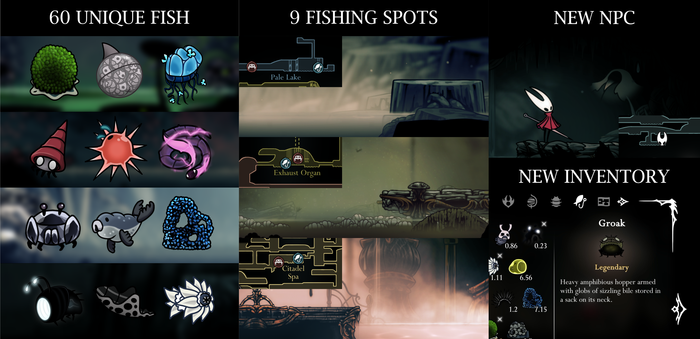

A mod that adds a fishing minigame to Hollow Knight: Silksong.

# Installation
1. Install BepInEx 5 for Silksong
2. Download `PharloomFishing.dll` and place it in the `BepInEx/plugins` folder
3. Run the game

Can also be installed automatically via [Thunderstore Mod Manager](https://www.overwolf.com/app/thunderstore-thunderstore_mod_manager) or [Cogfly](https://github.com/Nix-main/Cogfly).

# Features
### How to play
1. Find the new Hungry Craw NPC in Greymoor. Talk to him to receive the Fishing Kit item. 
2. Once you have it, you'll see fishing spots marked on your map.
3. At a fishing spot, you play a reaction-based minigame to catch fish.
4. You can view the fish you've discovered and your current haul in the Fishing inventory.
5. Return to the Hungry Craw with fish to sell them for rosaries.

### Massive thank you to RPGenocraft for providing some of the fish designs for this mod. Check out their post [here](https://bsky.app/profile/rpgenocraft.bsky.social/post/3mdxskxizus22).
